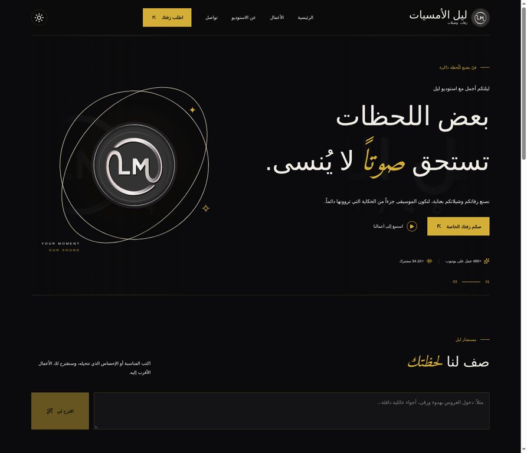
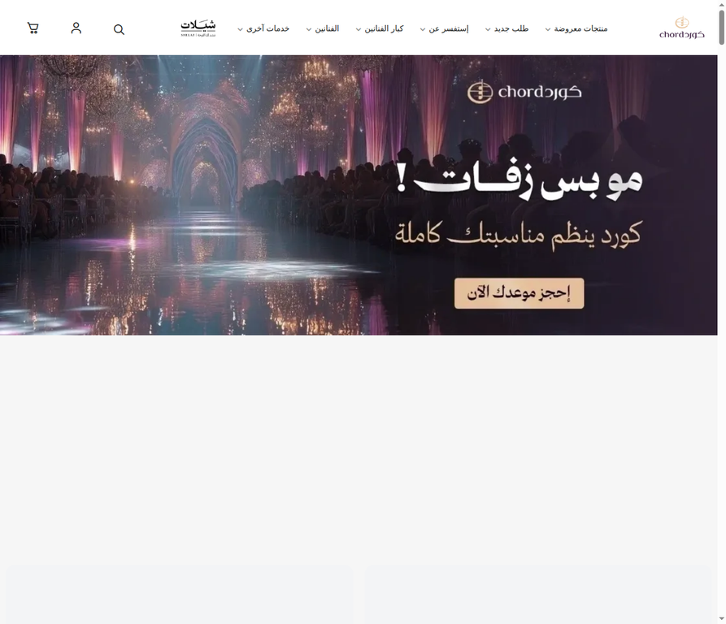
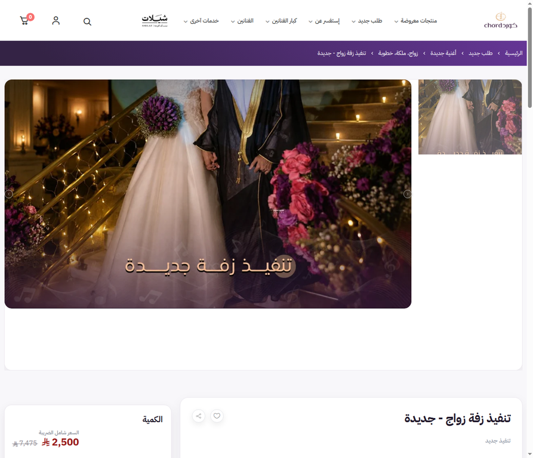

# تقرير تحليلي مقارن: Studio Layl مقابل Chord Studio

**إعداد:** Manus AI  
**تاريخ الفحص:** 9 نوفمبر 2026  
**النطاق:** واجهة المستخدم وتجربة المنتج ومنظومة إنتاج/بيع الأعمال الصوتية.  
**المشروع المحلي:** Studio Layl، النسخة المدفوعة إلى GitHub في المستودع `7thramzy/studio-layl`.  
**المرجع المنافس:** [chord-studio.com](https://chord-studio.com).

## الحكم التنفيذي

المنصتان لا تتنافسان بالطريقة نفسها تمامًا. Studio Layl مبني كواجهة علامة فنية ذات تجربة استماع وتخصيص مباشرة، بينما Chord Studio مبني كمتجر إلكتروني واسع التصنيف يعتمد على عمق الكتالوج، صفحات المنتجات، السعر، السلة، والتنفيذ التجاري. لذلك يتفوق Studio Layl في **التميّز البصري، وضوح الشخصية، الاستماع المستمر، والتحويل من العمل المعروض إلى طلب مخصص**. ويتفوق Chord Studio في **اتساع بنية المعلومات، قابلية اكتشاف المنتجات، نمذجة الخدمات والباقات، وإشارات الثقة التجارية**.

المشكلة الجوهرية في Studio Layl ليست نقص المزايا، بل أن بعض المزايا المهمة لا تزال تعمل كطبقة واجهة فوق تدفق WhatsApp أو معاينة مركّبة بدل أن تكون نظامًا صوتيًا تجاريًا مكتملًا. أما المشكلة الجوهرية في Chord Studio فهي عكسية: العمق التجاري كبير، لكن كثافة القوائم والتصنيفات والمنتجات ترفع العبء المعرفي، وتضعف الإحساس بأن المستخدم داخل “استوديو” تفاعلي موحّد. التوصية التصميمية الأقوى ليست نسخ أحدهما، بل الحفاظ على هوية Studio Layl وتجربة مشغله مع استعارة طبقات Chord التجارية المنظمة: كتالوج قابل للتصفح، صفحة منتج حقيقية، باقات واضحة، وسلة/طلب قابل للتتبع.

## الأدلة البصرية

## منهج المقارنة وحدودها

تم فحص كود Studio Layl ومكوناته وأنماطه، ثم تشغيله محليًا على Vite وفحص الصفحة الناتجة. شمل ذلك `StudioLayl.tsx` و`studio-layl.css` و`styles.css` وملفات المعاينة، إضافة إلى بنية Supabase وحقول الطلب. بالنسبة إلى Chord Studio، فحصت الصفحة الرئيسية وصفحة منتج حقيقية متاحة للعامة، مع تحليل HTML والروابط والصور والنماذج. [1] [2] [3]

لا يمكن إثبات بعض التفاصيل الداخلية في Chord Studio من دون حساب عميل أو إكمال عملية شراء، مثل قواعد التحقق خلف الخادم، تخزين الطلبات، سلوك السلة بعد الدفع، أو وجود مشغل صوتي داخل كل منتج إذا كان محملًا بعد JavaScript. لذلك أميز أدناه بين **مرصود** و**مستنتج** و**غير مثبت** بدل افتراض أن كل ما لا يظهر في HTML غير موجود.

---

# 1. الهوية البصرية ونظام التصميم

## 1.1 لوحة الألوان والموضوع

**Studio Layl يستخدم هوية داكنة فاخرة ومحددة بوضوح.** النواة اللونية في `studio-layl.css` هي خلفية شبه سوداء `#0b0b0d`، لوح داخلي `#141417`، نص فاتح `#f1eee7`، نص ثانوي `#99948c`، وذهبي `#d4af37` بوصفه لون التركيز والنداء إلى الإجراء. الوضع الفاتح موجود فعليًا عبر `data-theme` ويحوّل الخلفية إلى `#f7f5f0` والذهبي إلى `#a78325`. هذا نظام صغير ومتماسك؛ الذهبي لا يوزع عشوائيًا بل يميز الفعل، الحالة النشطة، الميتاداتا، والمشغل. [4]

النتيجة البصرية هي إحساس “استوديو/علامة فنية” أكثر من إحساس “متجر”. الخلفية الداكنة تسمح للغلاف والشعار والعناصر الذهبية بالظهور، بينما تمنح الشفافية و`backdrop-filter` الهيدر والبطاقات والمشغل إحساسًا زجاجيًا معاصرًا. الخطر هو أن الذهب مستخدم في عدد كبير من الوظائف، ولذلك يمكن أن تتقارب دلالات “التركيز” و“الزينة” و“الزر الأساسي”. كما أن درجة التباين في بعض النصوص الصغيرة الرمادية على الداكن تحتاج مراجعة عملية، لا سيما في أحجام 8–10px.

**Chord Studio يستخدم هوية متجر فاتحة تصويرية.** الواجهة المرصودة تعتمد خلفية بيضاء، بطاقات بيضاء، صورًا كبيرة وملونة، أزرارًا وشرائح وردية/بنفسجية فاتحة، ونصًا عربيًا داكنًا. العلامة البصرية تأتي من الصور والمنتجات وشعار المتجر أكثر مما تأتي من نظام لوني صارم. الصور تُظهر مناسبات وأشخاصًا وفناني زفات، فتبيع النتيجة النهائية مباشرة. الصفحة الرئيسية تستخدم Hero تصويريًا مع عبارة دعوة للحجز، ثم تنتقل إلى المنتجات والتصنيفات. [2]

هذا الاختلاف مقصود وظيفيًا: Studio Layl يبيع **الإحساس والهوية**؛ Chord Studio يبيع **اختيارًا تجاريًا واسعًا**. الأول أكثر تميزًا وقابلية للتذكر، والثاني أكثر ألفة لمستخدم المتجر العربي الذي يبحث عن سعر ومنتج وتصنيف.

## 1.2 الطباعة والهرم البصري

في Studio Layl تظهر `Alexandria` كخط أساسي، مع `Amiri` للعناوين التعبيرية والكلمات المائلة والاقتباسات، و`Georgia` أو `Inter` في مواضع محدودة. هذا يعطي تمييزًا واضحًا بين واجهة معلوماتية حديثة وبين صوت عربي شعري. العنوان الرئيسي كبير، قليل الكلمات، وتدعمه جملة وصفية قصيرة وزران واضحان. الهرم البصري قوي في Hero: العلامة الصغيرة، ثم العنوان، ثم الوصف، ثم CTA، ثم مؤشرات الثقة. [4]

الضعف المقابل هو أن بعض النصوص الوظيفية صغيرة جدًا؛ أحجام 8–11px مناسبة للميتاداتا فقط، لا للعناصر التي يعتمد عليها المستخدم في البحث والفرز. في الجوال، قد تصبح أسماء الأعمال والوصف والوسوم متقاربة، خصوصًا مع بطاقات ذات عمودين.

في Chord Studio يظهر `IBM Plex Sans Arabic` ضمن CSS العام المرصود. التصميم أكثر تقليدية في هرم العنوان والمنتج: اسم المنتج، الفنان، التقييم، السعر، ثم الإجراء. ميزة هذا الأسلوب أن السعر والشراء قابلان للاكتشاف في سياق التجارة. عيبه أن كثرة العناوين المتجاورة في القائمة الطويلة، مع عشرات التصنيفات والفنانين، قد تجعل المستخدم يقرأ شجرة تنقل بدل أن يتبع قصة استخدام واضحة. [2] [3]

## 1.3 المساحات، الحدود، الزوايا، والارتفاع

Studio Layl يستخدم شبكة واسعة نسبيًا: حاوية حتى 1600px وحواشٍ 6% على سطح المكتب، أقسامًا عمودية بفراغ 100px، وفواصل ذهبية رفيعة. البطاقات والمودالات ذات زوايا شبه حادة أو غير مستديرة، بينما الأزرار الدائرية مخصصة لأفعال الوسائط مثل التشغيل والمفضلة. هذا قرار جيد لأن المنتج يبدو كهوية فنية تحريرية لا كلوحة SaaS.

Chord Studio أقرب إلى نظام متجر: صور مستطيلة كبيرة، بطاقات منفصلة، مساحة بيضاء واضحة، وأزرار ذات زوايا ناعمة. الارتفاع البصري يأتي من الصورة والسعر والحالة التجارية، لا من الظلال الثقيلة. النظام أقل تجريدًا وأكثر اعتمادًا على محتوى المنتج.

## 1.4 مكتبة المكونات

الكود المحلي يحتوي على مجموعة shadcn/Radix كبيرة، مع `Dialog`, `Drawer`, `Select`, `Tabs`, `Slider`, `Sonner`, `Form` وغيرها، لكن الواجهة الرئيسية الفعلية تعتمد بدرجة كبيرة على CSS مخصص ومكونات داخل `StudioLayl.tsx`. هذا يمنح حرية بصرية عالية، لكنه يخلق مسارين للتصميم: نظام shadcn العام، وهوية Studio Layl الخاصة. التحدي المستقبلي هو منع اختلاف حالات التركيز، الحقول، الحوارات، والرسائل بين المسارين. [5]

Chord Studio يبدو مبنيًا على قالب تجارة Salla مع تخصيص بصري. الدليل هو ملفات CSS وموارد CDN الخاصة بثيم Salla، إضافة إلى نمط الروابط التصنيفية وتدفق السلة. ميزته النضج في أنماط المتجر، وسلبيته أن المكونات قد تبدو عامة أو متشابهة مع متاجر أخرى ما لم تعوضها الصور والهوية.[2]

### خلاصة المحور

| البعد | Studio Layl | Chord Studio | الأفضلية |
|---|---|---|---|
| التميز البصري | داكن، ذهبي، هوية استوديو واضحة | فاتح، تصويري، هوية متجر | Studio Layl |
| قابلية قراءة السعر والشراء | ضعيفة نسبيًا؛ السعر غير مركزي | قوية وواضحة في صفحة المنتج | Chord Studio |
| وضوح النظام اللوني | محدود ومتماسك | عملي لكن أقل تميزًا | Studio Layl |
| المرونة التجارية | تعتمد على مودال وWhatsApp | مبنية على منتج وسلة | Chord Studio |
| التعبير العاطفي | قوي جدًا | قوي عبر الصور والشهادات | Studio Layl |

---

# 2. الهيكلية المعمارية وتخطيط الشاشات

## 2.1 الهيدر والتنقل

Studio Layl يقدم أربعة روابط سطحية: الرئيسية، الأعمال، عن الاستوديو، تواصل، مع CTA واحد هو “اطلب زفتك”. على الجوال تتحول القائمة إلى قائمة منسدلة بسيطة، والهيدر sticky مع خلفية زجاجية. هذا يقلل عدد القرارات، ويجعل المسار الأساسي واضحًا: شاهد → استمع → خصص/اطلب. [4]

Chord Studio لديه بنية تنقل عميقة جدًا. الصفحة العامة تعرض “منتجات معروضة”، ثم زفات زواج، تخرج، شيلات، مناسبات أخرى، معزوفات، طلب جديد، فنانين، وخدمات أخرى. تحت كل فئة توجد فئات فرعية كثيرة: طلة، مسار، كوشة، تقطيع الكيكة، وداعية، عريس، ملكة، وغير ذلك. هذا مناسب لمستخدم يعرف ما يريد، ولكنه يرفع كلفة الاستكشاف لمستخدم ما يزال في مرحلة اختيار الإحساس أو نوع العمل. [2]

**النتيجة:** Studio Layl أفضل في الوصول إلى “الخطوة التالية”، وChord Studio أفضل في الوصول إلى “أي شيء موجود داخل الكتالوج”.

## 2.2 الصفحة الرئيسية

Studio Layl يبدأ برسالة علامة واضحة، أرقام اجتماعية، CTA، ثم مستشار ليل، ثم مكتبة أعمال، ثم CTA للتخصيص، ثم آراء وتواصل. الصفحة مصممة كقصة عمودية. وجود مستشار ليل مهم لأنه يضيف طبقة اكتشاف بالوصف الشعوري وليس فقط بالفئة؛ المستخدم يكتب مثلًا “دخول العروس بهدوء ورقي” ثم يحصل على اقتراحات. [4]

Chord Studio يبدأ بعرض تجاري واسع: Hero للحجز، ثم منتجات وفئات وفنانين وآراء عملاء. عدد الروابط المرصودة في الهيدر والقائمة كبير، لكن هذا يتيح الوصول المباشر إلى الفنان أو المناسبة أو نوع الزفة. الموقع يستفيد من اتساع المنتجات، غير أن كثافة الصفحة تجعل المستخدم يحتاج إلى فلترة ذهنية مستمرة.

## 2.3 الشريط الجانبي والقوائم السفلية

لا يظهر Sidebar دائم في Studio Layl. القائمة الرئيسية منسدلة فقط على الجوال، ولا توجد قائمة سفلية تنقل المستخدم بين أقسام التطبيق. هذا مناسب لموقع علامة أحادي الصفحة، لكنه لا يتسع بسهولة عندما يضاف حساب عميل، طلبات سابقة، ملفات صوتية، مراجعات، أو لوحة تسليم.

Chord Studio يستخدم نمط متجر متعدد المستويات، وليس Sidebar تطبيقيًا. المسار الأعمق يعتمد على صفحات التصنيف وصفحات المنتج. هذا أكثر قابلية للتوسع ككتالوج، لكنه يطلب من المستخدم فهم بنية المتجر قبل الوصول إلى خدمة مخصصة.

## 2.4 الاحتكاك ومسار الهدف

في Studio Layl، يمكن الوصول إلى طلب عام من الهيدر أو Hero أو قسم التخصيص، ويمكن من بطاقة عمل فتح “خصّصه باسمك”، ثم يظهر اسم العمل داخل التفاصيل. هذه نقطة قوية: السياق ينتقل من الكتالوج إلى الطلب بدل أن يبدأ المستخدم من نموذج فارغ. [4]

في Chord Studio، الوصول إلى منتج محدد يمر غالبًا عبر التصنيف ثم بطاقة المنتج ثم صفحة التفاصيل. مقابل ذلك، صفحة المنتج أكثر تجارية وتعرض الباقات، السعر شامل الضريبة، المنتجات المشابهة، ومنتجات شاهدها العملاء. في صفحة التنفيذ الجديد، يوضح النص أن التنفيذ يقوم على نموذج الطلب وتحت إشراف العميل، مع اختيار الفنان والقصيدة واللحن والباقات البرونزية والفضية والبلاتينية. [3]

### خلاصة المحور

- Studio Layl يفوز في **المسار القصير من الشعور إلى الاستماع إلى الطلب**.
- Chord Studio يفوز في **الاكتشاف الواسع والبيع المنظم لعدد كبير من أنواع المنتجات**.
- Studio Layl يحتاج مع نموه إلى طبقة معلوماتية ثانية، لا إلى زيادة الروابط داخل الهيدر.

---

# 3. مشغل الصوت وعناصر تفاعل الاستوديو

## 3.1 بطاقة الصوت والموجة

Studio Layl يملك تصورًا واضحًا للهوية الصوتية داخل البطاقة: موجة waveform مرسومة بـ19 عمودًا ذهبيًا، زر تشغيل مركزي، رقم العمل، مفضلة، وسمة “اختيار الاستوديو”. البطاقة تعرض الفئة والمدة والفنان والوصف ووسوم النسخ، ثم أفعال التخصيص والكلمات والمشاركة ويوتيوب. هذا يجعل البطاقة وحدة استماع ومشاركة وطلب، لا مجرد صورة منتج. [4]

لكن waveform الحالية **تمثيلية وليست موجة مستخرجة من ملف الصوت**. كما أن المصدر قد يكون معاينة Synth مركبة عند عدم وجود ملف صوتي، مع `duration` ثابتة 30 ثانية تقريبًا. هذا مقبول كـpreview تجريبي، لكنه لا يساوي مشغلًا احترافيًا يعتمد على waveform حقيقية، markers، تحميل تدريجي، ومعلومات عن جودة الملف.

في Chord Studio، الصفحة الرئيسية المرصودة تعرض بطاقات ذات صور أو صور مصغرة مرتبطة بنسخ “موسيقى/إيقاع/دفوف” في أسماء الصور والمنتج، لكن HTML المفحوص لا يحتوي على عناصر `<audio>` مباشرة. لذلك يمكن إثبات وجود عرض بصري للنسخ والمنتجات، ولا يمكن إثبات من HTML وجود waveform أو مشغل صوت مستمر. صفحة المنتج تركز على الصور والمنتج والسعر والباقات أكثر من التركيز على timeline صوتية. [2] [3]

## 3.2 المشغل العائم وحالاته

Studio Layl يتفوق بوضوح في هذه النقطة. عند اختيار عمل يظهر dock ثابت أسفل الشاشة، يعرض اسم العمل والفنان، السابق/التالي، تشغيل/إيقاف، timeline قابلة للسحب، وقت البداية والنهاية، نسخ العمل، وزر “اطلب هذه باسمك”. كما يضيف `body padding-bottom` لتجنب تغطية المحتوى بالمشغل، ويضيف حالات focus واضحة و`safe-area-inset` للجوال. [4]

هذا تصميم صحيح من منظور استمرارية الاستماع: المستخدم لا يفقد السياق عند النزول إلى البطاقات أو قسم التواصل. مع ذلك، توجد ملاحظتان:

1. زرا السابق/التالي يستخدمان أيقونتي `SkipForward` و`SkipBack` بطريقة قد تكون غير بديهية بصريًا لأن السابق موضوع قبل التشغيل لكن اتجاه الأيقونة يحتاج تحققًا بصريًا في RTL.
2. لا توجد حالة مصغرة أو تحكم متقدم في مستوى الصوت، ولا قائمة تشغيل مستقلة، ولا حفظ لموضع الاستماع بعد إعادة التحميل.

لا يظهر في Chord Studio مشغل عائم مماثل في الصفحة العامة المرصودة. النموذج الظاهر أقرب إلى متجر فيديو/صور/منتج مع زر تشغيل على الصور المصغرة، وليس مساحة استوديو مستمرة. هذه ليست إدانة للمنصة؛ فوظيفتها التجارية الأساسية قد لا تتطلب مشغلًا مستمرًا، لكنها تعني أن Studio Layl يملك فرصة تميّز مباشرة في تجربة الاستماع.

## 3.3 الإحصاءات والوسوم والكتالوج

Studio Layl يعرض أرقامًا اجتماعية عامة (`+480 عمل على يوتيوب`, `+34.1K مشترك`) ويزيد عداد تشغيل العمل عبر RPC عند البدء، مع وسوم للنسخ، مفضلة محلية، ومشاركة deep link عبر `?work=`. هذه بنية جيدة لإشراك المستخدم، لكنها ما زالت أقل من نظام تحليلات حقيقي: لا يظهر سجل استماع، نسب إكمال، مصدر الزيارة، أو تقارير تفصيلية للإدارة. [4]

Chord Studio يقدم إشارات تجارية مختلفة: تقييمات نجوم، أسعار مخفضة، حالة نفاد الكمية، منتجات مشابهة، “العملاء اشتروا أيضًا”، وتصنيفات حسب الفنان والمناسبة. هذه ليست إحصاءات استماع لكنها أقوى في بناء قرار شراء اجتماعي وتجاري. [2] [3]

### خلاصة المحور

| البعد | Studio Layl | Chord Studio |
|---|---|---|
| مشغل مستمر | موجود وثابت أسفل الشاشة | غير مثبت في الفحص العام |
| waveform | موجودة بصريًا، تمثيلية | غير مرصودة في HTML العام |
| تبديل النسخ | مدمج داخل البطاقة والمشغل | يظهر كنسخ/منتجات منفصلة أو صور مرتبطة |
| مشاركة العمل | deep link مباشر | روابط منتج ومتجر |
| مؤشرات الثقة | مشتركون وأعمال | تقييمات، سعر، خصم، نفاد، شراء متقاطع |
| نضج التجارة الصوتية | متوسط | مرتفع تجاريًا، أقل تفاعلية صوتيًا |

---

# 4. مسار الطلب وتخصيص الخدمة

## 4.1 نموذج Studio Layl

نموذج Studio Layl هو Modal بعرض يصل إلى 570px، يدعم الاسم، نوع العمل، المناسبة، التاريخ، الجوال، النسخة الصوتية، الإضافات، والتفاصيل. عند فتحه من بطاقة عمل، يُحقن اسم العمل كسياق مرجعي داخل التفاصيل. زر الإرسال يفتح WhatsApp برسالة مُرمّزة، ويحاول في الوقت نفسه حفظ نسخة من الطلب في جدول `orders` للوحة الإدارة. [4]

هذه هندسة تحويل ممتازة من حيث السرعة والسياق، لكنها ليست نموذج تجارة مكتملًا. لا يوجد في الجزء المرصود:

- تحقق حي إلزامي للاسم أو المناسبة أو الهاتف.
- رفع ملف مرجعي من العميل.
- اختيار لحن من مكتبة أو ربط الباقة بالسعر.
- مراحل متعددة مع حفظ التقدم.
- رقم طلب أو صفحة تأكيد رسمية.
- حالة نجاح مؤكدة من WhatsApp ومن قاعدة البيانات معًا.
- دفع أو فاتورة داخلية.

إذن، Studio Layl يسهل **بدء المحادثة** أكثر مما يسهل **إدارة دورة الطلب كاملة**. كما أن وجود `sonner` ضمن مكتبة المكونات لا يعني أن التدفق يستخدم Sonner فعليًا؛ المكون الحالي يستخدم Toast مخصصًا في الصفحة. هذه فجوة اتساق بين البنية المتاحة والتنفيذ الفعلي.

## 4.2 نموذج Chord Studio

Chord Studio يوزع الطلب على نموذج متجر وصفحات منتجات. الصفحة العامة تعرض تصنيفات “طلب جديد” متعددة، منها تنفيذ أغنية، تنفيذ زفة متكاملة، تأليف معزوفة، تعليق صوتي، كتابة وإلقاء قصيدة، تلحين قصيدة، مونتاج فيديو، وتصميم بطاقة. [2]

في صفحة التنفيذ الجديد، يتم شرح أن التنفيذ يُبنى على نموذج الطلب وتحت إشراف العميل، مع اختيار الفنان والقصيدة واللحن، ثم عرض ثلاث باقات: برونزية، فضية، وبلاتينية، مع اختلاف في جودة التوزيع والهندسة وإمكانية الآلات الحية. السعر ظاهر وموسوم بأنه شامل الضريبة. [3]

هذا أقوى من Studio Layl في **تجسيد نطاق الخدمة وتحويله إلى منتج قابل للشراء**. لكن الصفحة التي أمكن فحصها لم تُظهر حقول النموذج الفعلية أو رفع الملفات؛ لذلك لا يمكن الجزم بجودة live validation أو رسائل الخطأ. كذلك فإن تقسيم الخدمات إلى صفحات ومنتجات يزيد عدد الخطوات، خصوصًا إذا كان المستخدم يحتاج استشارة قبل معرفة أي منتج يناسبه.

## 4.3 المقارنة حسب معيار UX

| معيار | Studio Layl | Chord Studio | التقييم |
|---|---|---|---|
| بدء الطلب | نقرة من الهيدر/البطاقة إلى مودال | تصنيف ثم منتج/صفحة طلب | Studio Layl أسرع |
| تخصيص العمل | نسخة، إضافات، تفاصيل، مرجع | فنان، قصيدة، لحن، باقات حسب الصفحة | Chord أعمق تجاريًا |
| رفع مراجع | غير موجود في النموذج الحالي | غير مثبت من الفحص العام | فجوة مشتركة محتملة |
| الأسعار والباقات | غير ظاهرة في الطلب | ظاهرة في المنتج والباقات | Chord Studio |
| التأكيد | WhatsApp + حفظ best effort | سلة/منتج/دفع متوقع من بنية المتجر | Chord Studio |
| تقليل القلق | تواصل مباشر وسريع | سعر، تقييم، خصم، تفاصيل تجارية | متعادلان بأسلوبين مختلفين |

---

# 5. الوصول، الاستجابة، والأداء المدرك

Studio Layl يملك نقاطًا قوية في الاستجابة: breakpoints عند 900 و650 و380px، تحول البطاقات من ثلاثة أعمدة إلى عمودين ثم عمود واحد، نموذج الطلب يتحول إلى عمود واحد، والقائمة تصبح منسدلة. كما توجد `:focus-visible`، دعم `prefers-reduced-motion`، وارتفاعات لمس لا تقل غالبًا عن 44px للأفعال الرئيسية. [4]

في المقابل، مشغل dock الثابت كثيف على الجوال؛ الاسم، السابق، التشغيل، التالي، timeline، النسخ، وزر الطلب كلها تتنافس على المساحة. CSS يعالج ذلك بتحويل timeline إلى صف مستقل وترقية زر الطلب إلى عرض مرن، لكنه يحتاج اختبارًا على أجهزة بعرض 320–375px مع أسماء طويلة.

Chord Studio يعتمد على قالب متجر متجاوب، والصور والبطاقات مناسبة للاكتشاف البصري. غير أن كثرة التنقلات والقوائم قد تجعل الأداء المدرك أقل مباشرة، خاصة على الهاتف حيث يتراكم المحتوى قبل الوصول إلى المنتجات. الصور الكثيرة عامل قوة تجاري وعامل تكلفة أداء في الوقت نفسه. الفحص الحالي يثبت وجود 65 صورة في الصفحة الرئيسية، وهو رقم يبرر مراقبة التحميل الكسول وحجم الصور. [2]

من ناحية البنية، Studio Layl يملك تحكمًا مباشرًا في الأداء لكنه يحمل حزمة عميلة كبيرة نسبيًا؛ البناء أظهر chunk رئيسيًا يقارب 593KB قبل الضغط، مع تحذير Vite من حجم chunk أكبر من 500KB. Chord Studio يستفيد من منصة تجارة جاهزة، لكن لا تتوافر هنا قياسات Core Web Vitals موحدة، لذلك لا يصح إعلان فائز أداءً دون اختبار متزامن من نفس الجهاز والشبكة.

---

# 6. الثقة، التجارة، والهوية

Studio Layl يبني الثقة عبر لغة وجدانية، أعمال يوتيوب، عدد المشتركين، آراء العملاء، ووسائل اتصال مباشرة متعددة. هذا مناسب لخدمة إبداعية تحتاج محادثة وثقة شخصية.

Chord Studio يبني الثقة عبر بنية متجر أكثر اكتمالًا: أسعار، خصومات، تقييمات، حالات توفر، صفحات فئات، منتجات مشابهة، باقات، وبيانات تجارية ظاهرة في أسفل الصفحة مثل السجل التجاري والرقم الضريبي في صفحة المنتج. [3] هذه العناصر تقلل عدم اليقين في قرار الشراء، خصوصًا لمن يريد مقارنة ميزانية قبل التواصل.

النقطة التي ينبغي عدم تجاهلها هي أن كثرة إشارات الفنانين في Chord Studio تحمل قيمة اكتشاف قوية، لكنها قد تخلق حساسية قانونية أو توقعات تجارية إذا لم تكن العلاقة بين اسم الفنان ونوع التنفيذ واضحة. التقرير لا يحكم على الوضع القانوني؛ يثبت فقط أن الفنانين يستخدمون كطبقة تصنيف واكتشاف رئيسية في الموقع. [2]

---

# 7. مصفوفة التقييم النهائية

التقييم التالي يقيس ملاءمة التجربة لوظيفة “منصة إنتاج وبيع أعمال صوتية مخصصة”، وليس جمال الواجهة مجردًا.

| المحور | Studio Layl | Chord Studio | القراءة |
|---|---:|---:|---|
| وضوح الهوية البصرية | 9/10 | 7/10 | Layl أكثر تميزًا واتساقًا |
| التعبير العاطفي | 9/10 | 8/10 | Layl عبر اللغة والجو؛ Chord عبر الصور |
| اكتشاف الكتالوج | 6/10 | 10/10 | Chord يفوز بفارق كبير |
| سهولة البدء بالطلب | 9/10 | 7/10 | Layl أقصر وأكثر مباشرة |
| عمق نمذجة المنتج | 5/10 | 9/10 | Chord يملك منتجات وباقات وسعرًا |
| تجربة الاستماع | 9/10 | 5/10* | *بحسب ما أمكن إثباته علنًا |
| استمرارية المشغل | 9/10 | 4/10* | *لم يظهر مشغل عائم في الفحص العام |
| الثقة التجارية | 6/10 | 9/10 | Chord يوضح السعر والتقييم والبيانات |
| قابلية التوسع كتطبيق | 7/10 | 8/10 | Layl قوي كواجهة علامة؛ Chord قوي ككتالوج |
| اتساق التنفيذ الحالي | 7/10 | 7/10 | كلاهما يملك نقاط قوة وفجوات مختلفة |

**المحصلة:** Studio Layl = **7.6/10** كمنصة تجربة صوتية ذات هوية.  
Chord Studio = **7.4/10** كمنصة متجر واسعة للأعمال والخدمات الصوتية.

هذه النتيجة ليست حكمًا على حجم النشاط أو المبيعات، ولا تعني أن تجربة Chord Studio أقل نجاحًا تجاريًا؛ هي قراءة UX/UI لنطاق الفحص المتاح.

---

# 8. الفجوات ذات الأولوية في Studio Layl

## أولوية عالية

1. **تحويل نموذج الطلب من WhatsApp-first إلى Order lifecycle واضح.** يبقى WhatsApp قناة ممتازة، لكن يجب أن يحصل المستخدم على رقم طلب، حالة، ونتيجة نجاح موثوقة بعد الإرسال.
2. **إضافة صفحة/لوحة منتج حقيقية للعمل.** البطاقة الحالية ممتازة للاستكشاف، لكنها لا تعرض سعرًا أو باقات أو مدة تنفيذ أو شروط مراجعة كما تفعل صفحة Chord.
3. **استبدال waveform التمثيلية بموجة مستخرجة من الملف عند توفره.** يظل fallback المركب مفيدًا للمعاينة، لكن يجب أن يميز بصريًا بين “معاينة” و“ملف حقيقي”.
4. **إضافة رفع مرجع صوتي/فيديو/نص مع قيود نوع وحجم وتغذية راجعة واضحة.** هذه الوظيفة مركزية في إنتاج عمل مخصص ولم تظهر في النموذج الحالي.

## أولوية متوسطة

5. **بناء كتالوج هرمي خفيف، لا هيدرًا مزدحمًا.** يمكن إضافة صفحات أو فلاتر للمناسبة، الإحساس، الفنان، والنسخة، مع إبقاء Hero بسيطًا.
6. **توحيد المكونات.** إما اعتماد مكونات shadcn/Radix في الحوارات والحقول والرسائل، أو توثيق CSS الخاص كطبقة العلامة، حتى لا تبدو التجارب متباينة.
7. **إظهار دليل اجتماعي أكثر قابلية للتحقق.** عدد الأعمال والمشتركين مفيد، لكنه يحتاج إلى تحديث تلقائي أو رابط ومصدر واضح حتى لا يصبح رقمًا ثابتًا.
8. **ضبط كثافة مشغل الجوال.** الأفضل توفير حالة compact وحالة expanded بدل حشر كل عناصر التحكم في dock واحد.

## أولوية منخفضة

9. إضافة قائمة تشغيل وحفظ موضع الاستماع.
10. إضافة فرز حسب الأحدث، الأكثر تشغيلًا، المدة، ونوع النسخة.
11. إضافة تحليلات completion rate ومصدر الطلب داخل لوحة الإدارة.

---

# 9. الخلاصة التصميمية

Studio Layl يمتلك أصلًا أقوى من حيث الشخصية والتجربة: الهوية الداكنة الذهبية، اللغة العاطفية، المستشار الشعوري، وبنية المشغل العائم تمنحه موقعًا واضحًا كاستوديو صوتي لا كمتجر ملفات. لا ينبغي التضحية بهذه العناصر لصالح تقليد واجهة متجر عامة.

Chord Studio يثبت أن منصة الزفات تحتاج أيضًا إلى طبقة تجارة ومعلومات: تصنيفات عميقة، فنانين، صفحات منتج، أسعار، باقات، تقييمات، توفر، منتجات مشابهة، وبيانات ثقة. هذه العناصر لا تجعل التجربة أجمل بالضرورة، لكنها تجعلها قابلة للمقارنة والشراء والتوسع.

الاتجاه الأفضل لـStudio Layl هو **“استوديو ذو كتالوج تجاري”**: يبقى الاستماع والتخصيص في القلب، وتضاف حولهما صفحة منتج وباقات ورفع مراجع وحالة طلب وسعر أو نطاق سعري. بهذه الصيغة يحتفظ المشروع بتفوقه العاطفي والصوتي، ويغلق الفجوة التي يتفوق فيها Chord Studio حاليًا: تحويل العمل الفني من تجربة جميلة إلى عملية شراء وإنتاج قابلة للتتبع.

## المراجع

[1]: https://github.com/7thramzy/studio-layl "مستودع Studio Layl — النسخة المدفوعة إلى GitHub"

[2]: https://chord-studio.com "Chord Studio — الصفحة الرئيسية والكتالوج العام"

[3]: https://chord-studio.com/-/p738434444 "Chord Studio — صفحة تنفيذ زفة زواج جديدة"

[4]: https://github.com/7thramzy/studio-layl/blob/c66f736/src/components/StudioLayl.tsx "Studio Layl — مكون الواجهة والتفاعل"

[5]: https://github.com/7thramzy/studio-layl/tree/c66f736/src/components/ui "Studio Layl — مكونات shadcn/Radix UI"
